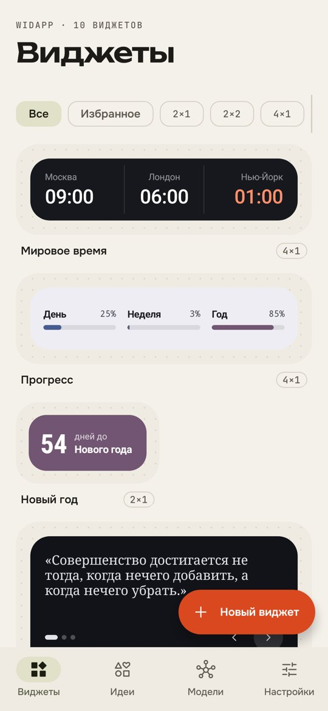
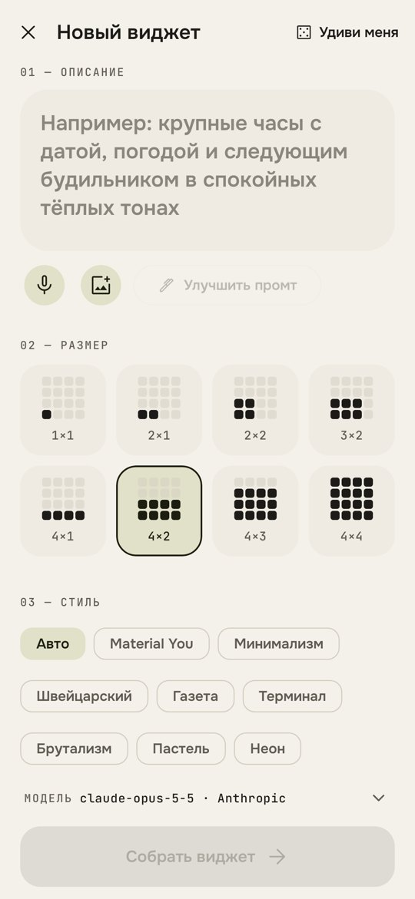
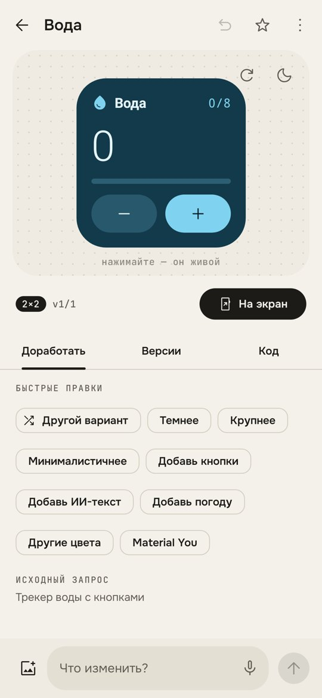
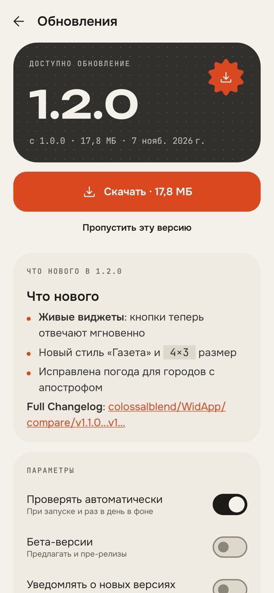
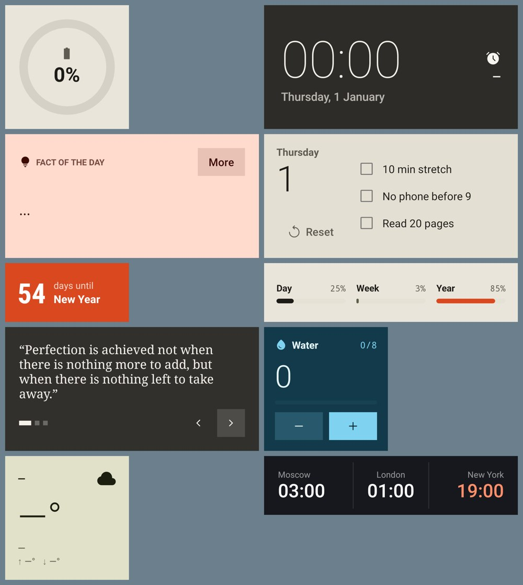

# WidApp

**Виджеты для Android, которые рисует ИИ.** Опишите словами, каким должен быть виджет, и WidApp соберёт его. Это нативный виджет рабочего стола, а не картинка: живые часы, данные, кнопки, страницы, счётчики и тексты, которые ИИ пишет сам.

Интерфейс сделан в Material 3 Expressive: шрифты Unbounded, Onest и JetBrains Mono, тёплая «бумажная» палитра с одним киноварным акцентом, холст с точечной сеткой, как в редакторе дизайна. Включается и Material You (цвета обоев).

<p>
   
</p>



<sub>Виджеты выше отрисованы тем же конвейером Glance → RemoteViews, что и на рабочем столе (скриншот-тесты).</sub>

## Возможности

### Создание
- **Промт → виджет.** Опишите идею, выберите размер и стиль, нажмите «Собрать виджет».
- **8 размеров:** 1×1, 2×1, 2×2, 3×2, 4×1, 4×2, 4×3, 4×4. Виджет масштабируется под реальную сетку лаунчера и тянется при ресайзе.
- **«Удиви меня»:** ИИ сам придумывает полезную идею под размер и собирает виджет.
- **«Улучшить промт»:** короткая мысль превращается в подробное ТЗ дизайнера.
- **Картинка-референс:** прикрепите скриншот или фото, и ИИ повторит композицию и цвета (нужна модель со зрением).
- **Голосовой ввод** промта.
- **12 стилей одним тапом:** Material You, минимализм, швейцарский, газета, терминал, брутализм, пастель, неон, ретро 70-х, стекло, игривый.

### Доработка
- **Чат-доработка:** «сделай темнее», «добавь кнопку сброса», «перенеси погоду вправо».
- **Быстрые правки:** другой вариант, темнее, крупнее, минималистичнее, добавить кнопки, ИИ-текст, погоду, другие цвета, Material You.
- **История версий** с откатом к любой из них.
- **Редактор кода:** виджет описан в JSON, его можно поправить руками.
- **Живое превью** на холсте: кнопки нажимаются, светлую и тёмную тему можно переключать.

### Интерактивные виджеты
Кнопки на виджете меняют то, что он показывает, прямо на рабочем столе:
- счётчики (`inc`, `dec`) с минимумом и максимумом;
- переключатели (`toggle`) и чек-листы с зачёркиванием;
- страницы (`pages`), листание (`cycle`, `prev`) и индикатор-точки;
- сброс (`reset`), обновление данных (`refresh`);
- запуск будильника, таймера, календаря, камеры, музыки, карт, ссылки или любого приложения (`open`).

### Живой ИИ-контент
Виджет может показывать текст, который ИИ пишет по расписанию: факт дня, слово дня, загадку с ответом по кнопке, шутку, комплимент, микрорассказ раз в час. Кнопка `{"do":"ai"}` на виджете сразу просит новый вариант. Уже показанные тексты не повторяются.

### Данные
Время и дата (обновляются сами, без расхода батареи), мировые часы, заряд и зарядка, следующий будильник, прогресс дня, недели, месяца и года, обратный отсчёт до даты, свободная память. Погоду даёт Open-Meteo: без ключа и без доступа к геолокации, город выбирается в настройках.

### Свои ИИ-провайдеры
| Провайдер | Протокол |
|---|---|
| OpenAI, OpenRouter, DeepSeek, Groq, Mistral, xAI, Together | OpenAI-совместимый |
| Anthropic (и Anthropic-совместимые прокси) | Messages API |
| Google Gemini | generateContent |
| Ollama, LM Studio, любой свой сервер | OpenAI-совместимый, можно по локальной сети |

**Модели подтягиваются автоматически.** Введите ключ, и WidApp сам запросит у провайдера список моделей (`/models`, `/v1/models`, `models.list`) и выберет подходящую по умолчанию. Если список недоступен, ID модели можно ввести вручную. Ключи шифруются в Android Keystore и не попадают в резервные копии.

### Обновления по воздуху (OTA)
WidApp сам обновляется из [Releases](https://github.com/colossalblend/WidApp/releases) этого репозитория:
- **Проверка** при запуске (не чаще раза в 6 часов) и раз в день в фоне. Используется ETag, поэтому повторные запросы не расходуют лимит GitHub API.
- **Экран «Обновления»:** номер версии прокручивается по цифрам, как на табло; во время проверки цифры перебираются, как в слот-машине. Список изменений из описания релиза отображается как Markdown, есть история всех версий.
- **Загрузка** с волнистым индикатором Material 3 Expressive, скоростью и оставшимся временем.
- **Три проверки перед установкой:** размер файла, SHA-256 (GitHub считает его для каждого файла релиза) и сертификат подписи. Подпись должна совпадать с установленным приложением, иначе установка не начнётся.
- **Установка** через системный PackageInstaller; разрешение «Установка неизвестных приложений» запрашивается один раз.
- **Остальное:** баннер «Доступно обновление» в библиотеке, точка на вкладке «Настройки», «Пропустить эту версию», бета-канал (pre-release), уведомление по желанию, окно «Что нового» после обновления.

## Установка

### Готовый APK
Последний релиз лежит в [Releases](https://github.com/colossalblend/WidApp/releases). Сборки с каждого push есть в **Actions** → запуск → артефакт `WidApp-…`.

### Подпись
- **Release** подписывается приватным ключом. Он хранится только в секретах GitHub Actions, в репозитории его нет. Без ключа release-сборка остаётся неподписанной, а тег вообще не соберётся.
- **Debug** подписывается общим ключом `app/debug.keystore`, только для разработки. Debug-сборку нельзя обновить до release и наоборот, подписи разные.

Секреты репозитория (Settings → Secrets and variables → Actions):

| Секрет | Значение |
|---|---|
| `WIDAPP_KEYSTORE_BASE64` | файл ключа в base64 |
| `WIDAPP_KEYSTORE_PASSWORD` | пароль хранилища |
| `WIDAPP_KEY_ALIAS` | alias ключа |
| `WIDAPP_KEY_PASSWORD` | пароль ключа |

Для локальной сборки release положите рядом с проектом `keystore.properties` (он в `.gitignore`) с ключами `storeFile`, `storePassword`, `keyAlias`, `keyPassword`.

> Сохраните ключ и пароли в надёжном месте. Без них нельзя выпустить обновление, которое встанет поверх уже установленных копий.

### Как выпустить версию (OTA)
```bash
git tag v1.1.0
```

```bash
git push origin v1.1.0
```

Workflow соберёт APK с `versionName 1.1.0`, подпишет его release-ключом, создаст релиз с автоматическим списком изменений и приложит `WidApp-1.1.0.apk` и `SHA256SUMS.txt`. Установленные копии увидят обновление сами. Теги с дефисом (`v1.2.0-beta.1`) публикуются как pre-release и приходят только тем, кто включил бета-версии. Релиз можно создать и через интерфейс GitHub: workflow запустится на созданный тег и приложит APK к этому релизу.

### Сборка самостоятельно
Нужны JDK 21 и Android SDK с `platforms;android-37.2`.

```bash
./gradlew :app:assembleDebug
```

APK появится в `app/build/outputs/apk/debug/`.

## Как пользоваться
1. **Модели** → выберите сервис → вставьте ключ → модели загрузятся сами → «Сохранить».
2. **Виджеты** → «Новый виджет» → опишите идею → «Собрать виджет».
3. В редакторе дорабатывайте виджет чатом, потом нажмите **«На экран»**.
   Можно и так: долгое нажатие на рабочем столе → Виджеты → WidApp → размер → выбрать дизайн.

## Формат виджета
ИИ отвечает JSON-объектом. Полная спецификация, которую получает модель, лежит в [`WidgetPrompt.kt`](app/src/main/java/app/widapp/ai/WidgetPrompt.kt). Короткий пример:

```json
{
  "name": "Вода", "size": "2x2", "background": "@primaryContainer",
  "state": {"cups": 0},
  "root": {"type": "column", "children": [
    {"type": "text", "text": "{cups}/8", "size": 40, "fontWeight": 300},
    {"type": "progress", "value": "{cups}", "max": 8},
    {"type": "button", "icon": "add", "onClick": {"do": "inc", "bind": "cups", "max": 12}}
  ]}
}
```

- **Узлы:** `column`, `row`, `box`, `pages`, `text`, `clock`, `icon`, `progress` (bar/ring), `button`, `check`, `dots`, `spacer`, `divider`.
- **Цвета:** `#RRGGBB`, `#AARRGGBB` или роли Material You (`@primary`, `@onSurface/60` …).
- **Токены:** `{battery}`, `{weather.temp}`, `{days_until:12-31}`, `{ai.fact}`, переменные состояния; тернарные выражения `{on ? 'Вкл' : 'Выкл'}`.

## Устройство
- `spec/`: язык описания виджетов, вычисление выражений, данные устройства.
- `widget/`: рендер в Jetpack Glance (RemoteViews), приёмники для 8 размеров, обработка нажатий, фоновое обновление (WorkManager), закрепление на экране.
- `ui/components/WidgetPreview.kt`: Compose-двойник рендера для живого превью.
- `ai/`: клиент для трёх протоколов, загрузка моделей, промт-контракт, генерация и живой контент.
- `update/`: OTA из GitHub Releases (semver, ETag, загрузка, SHA-256, сверка подписи, PackageInstaller, фоновая проверка).
- `ui/`: экраны «Виджеты», «Идеи», «Модели», «Настройки», «Создание», «Редактор».

Тесты (`./gradlew :app:testDebugUnitTest`) проверяют выражения и парсер, а через Robolectric и Roborazzi рисуют каждый пример виджета настоящим конвейером Glance → RemoteViews и снимают скриншоты экранов и экрана обновлений в `app/build/shots/`.

## Лицензии сторонних ресурсов
Шрифты Unbounded, Onest и JetBrains Mono распространяются под SIL OFL 1.1, иконки Material Symbols под Apache 2.0. Тексты лицензий лежат в `app/src/main/assets/licenses/`. Погода: [Open-Meteo](https://open-meteo.com).
